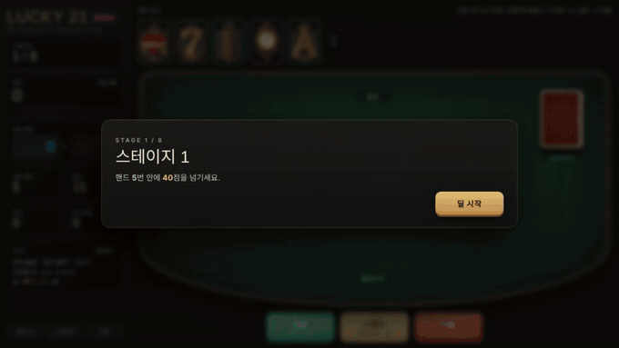
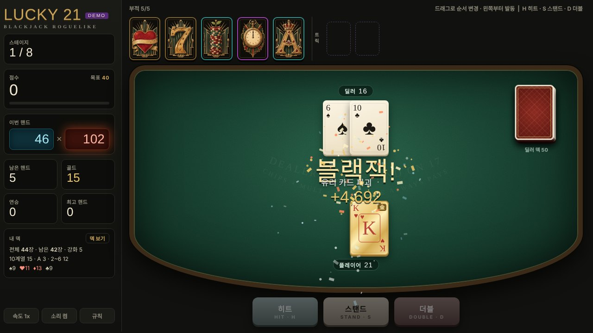
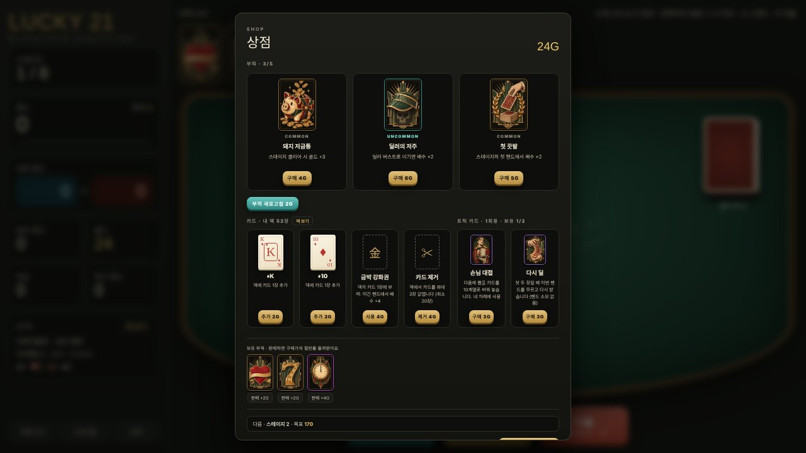
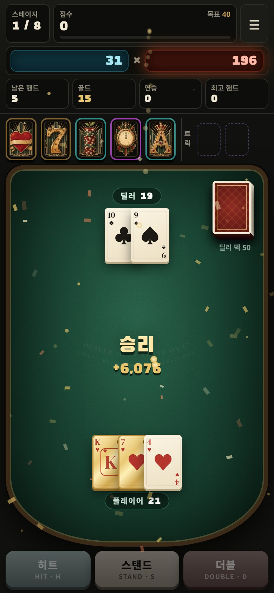

# LUCKY 21 — Blackjack Roguelike

**▶ 플레이: https://sin4691.github.io/lucky21/** (PC·모바일 브라우저) · 안드로이드 앱 빌드: [`app/`](app/README.md)

블랙잭에 덱빌딩 로그라이크를 결합한 게임입니다. 딜러를 이기면 **칩 × 배수**만큼 점수를 얻고, 8개 스테이지의 목표 점수를 넘기면 승리합니다. 상점에서 부적·카드·강화를 사서 **점수 공식과 내 덱을 직접 설계**합니다.

<p align="center"></p>

| 플레이 | 상점 | 모바일 |
|---|---|---|
|  |  |  |

> 처음 보는 분은 타이틀의 **데모 모드**를 눌러 보세요. 빌드가 완성된 상태로 시작해서 30초 안에 점수가 터지는 장면을 볼 수 있습니다.

---

## 설계 포인트

### 1. "문양 보너스가 의미 없다" → 덱빌딩으로 전환
첫 프로토타입은 블랙잭에 부적만 붙인 구조였습니다. 플레이테스트에서 *"하트 부적이 있어도 어차피 이기려고 하는 건 똑같다"*는 피드백이 나왔습니다. 블랙잭은 뽑을 카드를 고를 수 없어서, 문양 부적이 플레이어의 판단을 하나도 바꾸지 못했던 것입니다.

그래서 **플레이어가 자기 덱에서 뽑는 구조**로 바꿨습니다. 딜러는 별도 덱을 씁니다.
- 상점에서 카드를 **추가·강화·제거**해서 덱의 문양·숫자 분포를 직접 만듭니다.
- 하트를 늘리면 하트 부적이, 낮은 카드를 빼면 10 비율이 오르면서 블랙잭 확률이 달라집니다. 부적과 덱이 서로 시너지를 냅니다.

### 2. 히트/스탠드를 "감"이 아니라 "계산"으로
남은 내 덱을 기준으로 **다음 히트의 버스트 확률을 실시간 계산**해서 보여 줍니다. 덱을 바꾸면 확률이 바뀌기 때문에, 덱빌딩의 결과가 매 결정에 직접 드러납니다. 트릭 카드(다음 카드 미리보기, 10 확정 등)는 이 판단을 비트는 소모품입니다.

### 3. "무조건 이겨야 함"을 깨는 부적
버스트해도 하트 칩이 점수로 들어오거나, 버스트할수록 배수가 쌓이는 부적을 넣어서 **지는 것에도 쓸모**를 만들었습니다. 리스크를 감수할 이유가 생깁니다.

### 4. 데이터 주도 부적 시스템
부적 39종은 모두 [`js/data/charms.js`](js/data/charms.js)의 데이터 정의입니다. 세 가지 훅이 `{chips | mult | xmult | gold}`를 돌려주면, 점수 시퀀스가 그 순서대로 연출합니다.

```js
{ id:'spade', name:'흑검', rar:2, price:7, desc:'스페이드 카드 1장당 배수 ×1.3',
  perCard: c => c.s==='♠' && { xmult:1.3 } },          // 카드마다
{ id:'exact', name:'블랙잭 헌터', rar:3, price:8, desc:'합이 정확히 21이면 ×4, 3장 이상이면 ×7',
  onHand: x => x.total===21 && { xmult: x.cards.length>=3 ? 7 : 4 } },   // 핸드마다
{ id:'gambler', name:'도박꾼의 각오', ...
  onLose: (x, me) => x.result==='bust' && (me.val += 4, { note:'각오 +4' }) }  // 졌을 때
```
발동은 부적 칸의 **왼쪽부터** 순서대로라서, +배수를 앞에·×배수를 뒤에 두도록 드래그로 배치하는 것 자체가 전략이 됩니다.

### 5. 봇으로 밸런스 검증
헤드리스 브라우저(Playwright)에서 **규칙 기반 봇**을 여러 판 돌려 스테이지별 도달 분포를 보고 목표 점수·골드 보상을 조정했습니다. 봇은 기본 전략에 버스트 확률 기준 히트, 희귀도 우선 구매를 합니다.
- 1스테이지 탈락률이 높게 나왔을 때 승률(약 40%, 일반 블랙잭 수준)부터 확인해서 버그가 아닌 분산 문제임을 확인하고, 첫 목표를 낮춰 해결했습니다.

---

## 기능

- **덱빌딩 블랙잭**: 히트·스탠드·더블, 카드 추가/강화(금박·유리·보석·행운)/최대 3장 제거
- **시작 덱 5종**: 클래식, 붉은 연정(하트 26장), 하이롤러(2~5 없음), 금박(강화 10장), 부자(골드↑·핸드↓). 판마다 첫 전략이 달라짐
- **도감과 업적 해금**: 업적 7개로 덱 3종·부적 4종이 풀림. 발견한 부적·트릭 카드·보스를 모아 보는 도감
- **부적 39종 · 보스 규칙 10종 · 트릭 카드 5종**
- **엔드리스 모드**: 8스테이지 클리어 후 목표가 1.6배씩 오르며 계속
- **진행 자동 저장 · 이어하기**: 핸드 사이·상점에서 체크포인트. 덱 순서까지 저장해서 껐다 켜는 꼼수가 통하지 않음
- **첫 플레이 튜토리얼**: 첫 결정·첫 점수·첫 상점 순간에만 해당 UI를 스포트라이트로 강조
- **반응형 · 안드로이드 앱**: 창이 화면보다 크면 같은 디자인 그대로 비율 축소, 카메라 구멍(안전 영역) 대응, 뒤로가기 처리

## 연출

- 카드 딜·플립·3D 틸트, 카드 하나씩 점수가 쌓이는 시퀀스, 부적 발동 흔들림
- 점수 크기에 비례한 화면 흔들림·파티클·코인 비행
- 효과음은 Web Audio API로 실시간 합성 (오디오 파일 없음). 점수가 쌓일수록 음이 올라감

## 아트 파이프라인

- **코드로 그림**: 카드 앞뒷면, 테이블, 버튼, 패널. 반복되는 UI는 단순하고 일관되게 유지
- **AI 이미지 (GPT)**: 부적·트릭 카드 일러스트만. 스타일 문장을 고정하고 3×3 시트로 생성 → 칸별 자동 감지·크롭·리사이즈 스크립트로 규격화
- 플레이테스트 피드백으로 문양 부적은 "문양이 그림의 중심"이 되도록 다시 생성

## 구조

빌드 도구·외부 라이브러리 없이 HTML/CSS/JavaScript만 사용합니다.

```
index.html          화면 뼈대
css/style.css       스타일 (반응형·안전 영역 포함)
js/
  core/utils.js     공용 유틸
  data/             부적·보스·스테이지·트릭 카드·시작 덱·업적 정의 (콘텐츠는 여기만 고치면 됨)
  game/             블랙잭 규칙, 런 상태, 게임 진행·점수 계산, 저장, 기록, 메타 진행(도감·해금)
  ui/               렌더링, 카드 뷰, 상점, 덱 보기, 덱 선택·도감, 화면, 튜토리얼
  fx/               파티클·연출, 합성 효과음
  platform/         안드로이드 뒤로가기·확인창
  main.js           입력 바인딩과 부팅
assets/             부적·트릭 카드 일러스트
app/                Capacitor 안드로이드 프로젝트 (오프라인 글꼴 내장, 전체화면)
```

## 조작

| 키 | 동작 |
|---|---|
| H | 히트 |
| S | 스탠드 |
| D | 더블다운 |
| 드래그 | 부적 순서 변경 |
